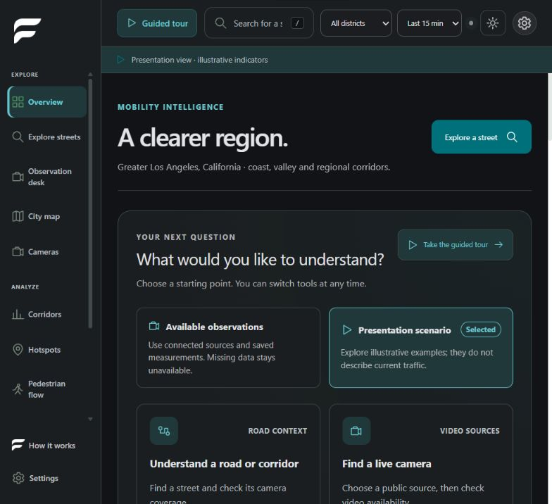
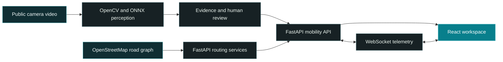

<p align="center">
  
</p>

<h1 align="center">City mobility intelligence, grounded in road evidence</h1>

<p align="center">
  <strong>Explore streets · inspect public cameras · compare corridors · support human review</strong>
</p>

<p align="center">
  <a href="https://flowsense.duckdns.org"></a>
  
  
  
</p>

<p align="center">
  
</p>

<p align="center">
  <em>One workspace to move from a street-level question to a well-informed next check.</em>
</p>

<p align="center">
  <a href="#-what-you-can-do">Explore features</a> ·
  <a href="#-get-started">Get started</a> ·
  <a href="#-how-it-fits-together">Architecture</a> ·
  <a href="#-documentation">Documentation</a>
</p>

---

## ✨ What you can do

FlowSense brings public camera sources, road-network context, mobility analysis and review workflows into one navigable workspace. Follow the built-in guide or jump straight to a task.

| Workspace | What it helps you do |
| --- | --- |
| **Overview & map** | Explore the regional context, map layers, linked road segments and source locations. |
| **Street explorer** | Search roads and cameras, compare nearby sources and check video availability. Proximity alone does not establish road coverage. |
| **Cameras & observation desk** | Inspect public video where available and compare up to four selected feeds with their independent source times. |
| **Corridors & hotspots** | Review road context, ranked items and the evidence behind a signal. |
| **Risk review & reports** | Keep a human in the loop, record decisions and prepare evidence-based exports. |
| **Emergency corridors** | Compare a selected route with a topology-based alternate and its overlap assessment. A result does not dispatch units. |
| **Guide & settings** | Learn the workspace through a navigable 14-topic tour; adjust appearance, data mode and source context. |

<p align="center">
  
</p>

### A guided path through the workspace


## 🧩 How it fits together



**Frontend:** React 19, TypeScript, Vite, Leaflet and Zustand. **Backend:** Python, FastAPI, OpenCV, ONNX Runtime and NetworkX. **Deployment:** Docker Compose with an Nginx single-page-app server and API/WebSocket proxy.

## 🚀 Get started

### Windows

Requires Python 3.13+ and Node.js 24 with npm. From PowerShell at the repository root:

```powershell
.\scripts\run_flowsense.ps1 -Setup
```

On later runs, use `scripts/run_flowsense.ps1`. Open [http://127.0.0.1:3002/overview](http://127.0.0.1:3002/overview). The launcher starts the Los Angeles API on port 8004 and the web interface on port 3002 by default.

### Run the frontend on its own

```powershell
cd frontend
npm ci
npm run dev
```

Vite serves the frontend on port 3001 and proxies `/api` and `/ws` to `http://127.0.0.1:8002` by default. See [`frontend/README.md`](frontend/README.md) and [`frontend/.env.example`](frontend/.env.example) for API configuration.

### Docker Compose

```bash
docker compose up --build
```

Compose serves Nginx on ports 80 and 5173, with the FastAPI service on port 8000. See the [AWS deployment and operations guide](docs/AWS_DEPLOYMENT.md) for production configuration and TLS.

## 🛠️ Development checks

Run from `frontend/`:

```bash
npm test
npm run build
npm run lint
```

Run the Python suite from the repository root:

```bash
python -m pytest -q
```

## 🛡️ Evidence, safety & privacy

- A camera appearing on a map does not prove that it sees a particular road. Check the source and viewing context.
- Public video, saved evidence, illustrative scenarios and live telemetry have different origins; the interface labels the distinction. Presentation examples are not live traffic measurements.
- Missing or unavailable data means **unknown**, not zero. Model detections and scores do not confirm an incident.
- Route estimates use the available road graph and speed assumptions. An alternate-route score describes overlap and detour, not the probability of arrival.
- FlowSense does not dispatch emergency vehicles, operate traffic signals, perform facial recognition or identify license plates.
- Public video sources can change or become unavailable. Availability depends on providers, connectivity and processing resources.

Read [product delivery and data boundaries](docs/PRODUCT_DELIVERY.md), the [public camera source notes](docs/PUBLIC_CAMERAS.md) and [privacy notice](docs/legal/PRIVACY_NOTICE.md).

## 📚 Documentation

<details>
<summary><strong>Product and frontend</strong></summary>

- [Frontend V3 overview](docs/FLOWSENSE_FRONTEND_V3.md)
- [Frontend journey and 14-topic guide](docs/FRONTEND_JOURNEY.md)
- [Frontend reliability and verification scope](docs/FRONTEND_RELIABILITY.md)
- [Explorer and observation desk](docs/EXPLORER_AND_OBSERVATION_DESK.md)
- [Product delivery and evidence boundaries](docs/PRODUCT_DELIVERY.md)
- [Brand assets and visual system](docs/BRANDING.md)
- [Product-reference guide and screenshots](docs/product-reference/README.md)

</details>

<details>
<summary><strong>Video, perception and road context</strong></summary>

- [Continuous video delivery and verification](docs/CONTINUOUS_VIDEO_DELIVERY.md)
- [Road-domain tracking and model comparison](docs/ROAD_DOMAIN_TRACKING.md)
- [Directional tracking](docs/DIRECTIONAL_TRACKING.md)
- [Night detection diagnosis and limits](docs/NIGHT_DETECTION_DIAGNOSIS.md)
- [Detection and persistence](docs/DETECTION_PERSISTENCE_PLAN.md)
- [Verified public camera sources](docs/PUBLIC_CAMERAS.md)

</details>

<details>
<summary><strong>Routing, deployment and pilots</strong></summary>

- [Road-network tracking](docs/ROAD_DOMAIN_TRACKING.md)
- [Regional expansion plan](docs/REGIONAL_EXPANSION_PLAN.md)
- [Cartagena pilot](docs/CARTAGENA_PILOT.md)
- [AWS deployment runbook](docs/AWS_DEPLOYMENT.md)
- [Backend v5](docs/FLOWSENSE_BACKEND_V5.md)
- [Project delivery notes](docs/PRODUCT_DELIVERY.md)

</details>

## 🌐 Live workspace

Try [flowsense.duckdns.org](https://flowsense.duckdns.org). The live workspace depends on public source availability and its current deployment configuration; the local setup above is available for development and review.

---

<p align="center">
  Built for clearer mobility decisions.<br />
  <sub>Evidence · context · human review</sub>
</p>

<p align="center">
  
</p>
