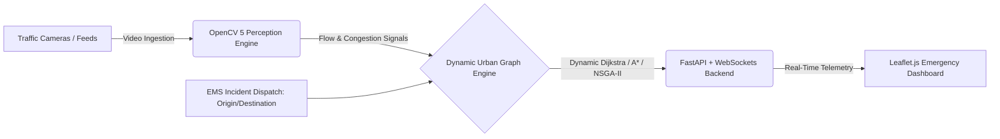

# FlowSense: City Mobility Intelligence [](https://flowsense.duckdns.org) [](https://opencv.org/) [](https://fastapi.tiangolo.com/)

> **Real-Time Computer Vision & Urban Graph Modeling for Emergency Vehicles (Ambulances & Fire Trucks)**
> Proposal for the **OpenCV AI Competition 2026, powered by AWS**.
> **Live Production Deployment**: [https://flowsense.duckdns.org](https://flowsense.duckdns.org)

FlowSense connects public camera evidence, aggregate movement observations, corridor
analytics, pedestrian context, prioritized review and emergency route support in one
navigable operations interface. The current catalog includes 86 official Caltrans
sources across seven Greater Los Angeles zones, with 61 distinct images checked
in the latest review and a real OpenStreetMap road graph. Explore streets and
nearby cameras, then compare up to four independent observations in the observation
desk. Official video URLs are retained for retry; their availability varies.
See [the explorer and observation desk](docs/EXPLORER_AND_OBSERVATION_DESK.md)
and [the regional plan](docs/REGIONAL_EXPANSION_PLAN.md) for verification and limits.
Historical indicators used for presentation are explicitly separated from observations.

## Run the product on Windows

Requires Python 3.13+ and Node.js 24 with npm:

```powershell
.\scripts\run_flowsense.ps1 -Setup
# On subsequent runs:
.\scripts\run_flowsense.ps1
```

Open `http://127.0.0.1:3001/overview`. The API uses port 8002. Camera images require
internet access; no Caltrans account, payment or API key is required. Sources may be
interrupted. The launcher downloads the LA graph and ONNX model when absent.

- [Frontend V3: complete change log and verification](docs/FLOWSENSE_FRONTEND_V3.md)
- [Street explorer, video recovery and observation desk](docs/EXPLORER_AND_OBSERVATION_DESK.md)
- [Detailed implementation plan](docs/PRODUCT_IMPLEMENTATION_PLAN.md)
- [Product delivery, verification and data boundaries](docs/PRODUCT_DELIVERY.md)
- [Verified public camera sources](docs/PUBLIC_CAMERAS.md)
- [Original frontend handoff](docs/product-reference/README.md)

Checks: `python -m pytest -q`, `python -m scripts.verify_los_angeles_integration`,
and, in `frontend/`, `npm test`, `npm run build` and `npm run lint`. The legacy test fixtures
pin Manhattan independently of the profile selected by the local launcher.

---

## One-Line Pitch

**FlowSense** turns camera-derived movement observations into city mobility intelligence: visible conditions, corridor context, prioritized human review and emergency route continuity.

For dispatch teams, FlowSense pairs each recommended corridor with a topology-based backup assessment, so an operator can see whether the alternate route depends on the same vulnerable streets. Camera-derived incident candidates can be reviewed before they affect routing, then exported as verified partner-feed events.

## Product Wedge: Dispatch Continuity

The target user is a municipal emergency dispatcher or traffic-management operator. FlowSense is designed to complement existing CAD and navigation tools with three connected steps: review roadway evidence, compare the primary emergency route with a lower-overlap fallback, and measure verification and clearance times. Verified events can be exported in Waze CIFS format for an agency-approved partner feed.

For the Cartagena pilot, confirmed and unexpired water-depth reports remove affected road nodes from emergency route calculations. A dispatcher sees the source, reported depth, confirmation state, expiry and alternate-route continuity. Pending and synthetic demo observations never silently change a route. The default water tolerance is 0 cm for both unit types; the agency must set approved operating limits before live use. See [Cartagena pilot setup and data limits](docs/CARTAGENA_PILOT.md).

---

## The Problem: The Golden Hour Bottleneck

Emergency response systems (EMS and Fire Departments) rely heavily on historical GPS routing or static distance calculations. During medical traumas or structural fires, every second counts towards the *"Golden Hour"*. Static models fail because they cannot perceive:

- Bottlenecks, gridlocks, or localized accidents occurring **in real time**.
- Bottleneck intersections where an emergency vehicle might get trapped without shoulder space.
- Dynamic lane clearance before the emergency vehicle arrives.

The challenge is not just calculating shortest paths on OpenStreetMap, but **grounding routing algorithms with real-time perception signals from municipal traffic cameras**.

---

## Solution Architecture

FlowSense bridges computer vision perception with graph optimization in a three-tier pipeline:



### 1. Perception Engine (OpenCV 5 — Core)

- **Ingestion:** Feeds from municipal/DOT traffic cameras or urban traffic datasets (UA-DETRAC, BDD100K).
- **Detection & Tracking:** Powered by OpenCV 5's dnn module executing lightweight ONNX-exported object detection models alongside `cv2.Tracker` and optical flow estimation.
- **Congestion & Impedance Extraction:** Aggregated vehicle counts, estimated average flow velocity, and road impedance factors per segment/intersection.

### 2. Urban Emergency Graph (osmnx + networkx)

- The city road network is represented as a directed graph derived from OpenStreetMap.
- Instead of static travel times, edge weights ($W_e$) adjust dynamically based on OpenCV congestion metrics:
  $$W_e = \text{Length} \times \left(1 + \alpha \cdot \text{CongestionFactor}\right)$$
- Emergency routing algorithms prioritize wide avenues, clearance velocity, and safety over purely physical shortest distances.

### 3. Dispatch Operations Dashboard

- **FastAPI** backend streaming recalculated routes, corridor clearance signals, and telemetry via WebSockets.
- **Leaflet.js** web frontend displaying an interactive 'digital twin':
  - Color-coded street congestion levels.
  - Active emergency units tracking along dynamically re-routing green corridors.

## AWS Cloud Architecture (Scoped to Free Tier)

Designed for practical, low-cost execution within AWS Free Tier limits:

- **Development & Prototyping:** Vision inference runs locally on sampled datasets to preserve cloud resources.
- **Stream Ingestion & Batch Store:** Amazon S3 for storing model weights, map extracts, and recorded evaluation clips.
- **Orchestration & Backend:** FastAPI app hosted on an AWS Free Tier EC2 instance (t2.micro / t3.micro), coordinating graph state and WebSocket clients.
- **Cost Controls:** Real-time billing alerts and usage caps enforced from day one.

## Tech Stack

| Domain | Technologies |
| :--- | :--- |
| **Computer Vision** | OpenCV 5 (dnn, tracking, optical flow), ONNX Runtime, YOLO-based models |
| **Urban Graph & Routing** | osmnx, networkx, scipy |
| **Backend & Real-Time** | Python 3.13+, FastAPI, WebSockets, Uvicorn |
| **Frontend & GIS** | Leaflet.js, HTML5, CSS3, GeoJSON |
| **Cloud & Deployment** | AWS (EC2, S3, IAM), Docker |

## Documentation

For deep technical dives into the specific modules, check the versioned documentation:

- [AWS Cloud Deployment & Operational Runbook](docs/AWS_DEPLOYMENT.md)
- [Backend v5.0: Advanced Dispatch, Docker AWS & CI](docs/FLOWSENSE_BACKEND_V5.md)
- [Perception Engine & Advanced Routing](docs/FLOWSENSE_PERCEPTION_AND_ROUTING_V4.md)
- [Backend Green Wave Simulation](docs/FLOWSENSE_BACKEND_V3.md)
- [Frontend Iteration 1](docs/FLOWSENSE_FRONTEND_V1.md)

## Roadmap (Aug 26 – Oct 26)

| Weeks | Phase | Core Deliverable | Status |
| :--- | :--- | :--- | :--- |
| 1–2 | Graph & Base Vision | Extract pilot city graph via osmnx. Implement initial vehicle detection with OpenCV 5. | ✅ Done |
| 3–4 | Density Metrics | Build road segment impedance algorithm based on vehicle counts and flow velocity. | ✅ Done |
| 5–6 | Emergency Routing Engine | Dynamic weight integration on networkx (A* Multi-criteria). Emergency clearance path selection. | ✅ Done |
| 7–8 | Real-Time Dispatch Dashboard | FastAPI WebSocket pipeline connected to interactive Leaflet.js command map. | ✅ Done |
| 9–10 | Cloud Deployment & Benchmarking | AWS EC2 production deployment, simulated response time benchmarks, and complete test suites. | ✅ Done |

## Engineering Team

- Dariem Garcia
- Jesus Campo Yuunes
- Thomas Cristhancho
- Daniel Franco

## Responsible AI & Privacy Guarantee

- **Zero Surveillance:** The perception engine processes aggregate vehicle counts and flow densities only.
- **Privacy by Design:** No facial recognition or license plate identification (ALPR) is performed or stored.
- **Data Compliance:** Uses exclusively public research datasets (UA-DETRAC, BDD100K) and open municipal streams without expectation of personal privacy.

## Getting Started

```bash
# Clone the repository
git clone https://github.com/Dmgar/project_Flowsense.git
cd project_Flowsense

# Create and activate environment (Python 3.13+)
python -m venv venv
source venv/bin/activate # Windows: venv\Scripts\activate

# Install dependencies
pip install -r requirements.txt
```

## AWS Cloud Deployment & Production SSL

FlowSense is containerized with Docker and optimized for AWS Free Tier (EC2 `t3.micro`, Amazon Linux 2023):
- **Live URL**: [https://flowsense.duckdns.org](https://flowsense.duckdns.org)
- **Architecture**: Multi-stage Nginx Alpine frontend (< 15 MB RAM) acting as reverse proxy for the FastAPI backend, static SPA, and real-time WebSockets (`/ws/telemetry`).
- **SSL**: Automatic Let's Encrypt TLS certificates via Certbot (`scripts/setup_ssl.sh`).
- **Deployment Script**: One-step automated deployment via `scripts/deploy_aws.sh` (configures swap memory, Docker buildx, and container orchestration).

## License

This project is licensed under the MIT License - see the [LICENSE](https://www.google.com/search?q=LICENSE) file for details.
